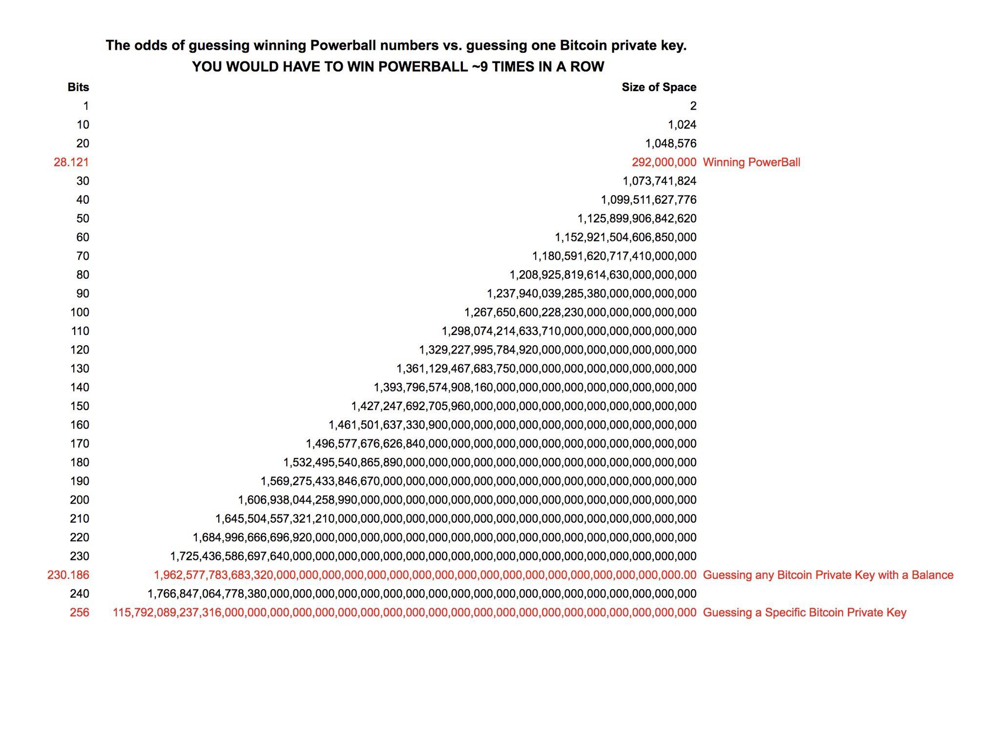

# 🎰 Bitcoin Roulette - The Ultimate Lottery (That You'll Never Win) 🎰

Ever wondered what it would be like to win the Bitcoin lottery? Well, this is your chance! Sort of... 😅

This is a fun educational project that generates random Bitcoin seed phrases and checks if they have any funds. **Spoiler alert:** You're not going to find anything. But that's the whole point! This project demonstrates why Bitcoin is so secure - the odds are literally astronomical.

> ⚠️ **For educational purposes only!** This is meant to teach you about cryptography, not to actually find Bitcoin. If you're here to steal crypto, you're in the wrong place (and also wasting your time).

## 🎯 What Does This Do?

Think of it like a slot machine, but instead of cherries and lemons, you're spinning for Bitcoin addresses! The script:

- 🎲 Generates random 12-word seed phrases (BIP39)
- 🔑 Derives Bitcoin addresses from those seeds
- 💰 Checks if those addresses have any Bitcoin
- 📊 Shows you cool statistics about how impossible this actually is
- 💾 Saves any "wins" to a file (don't hold your breath!)

## 🚀 Quick Start

```bash
# Install dependencies
pip install -r requirements.txt

# Run the lottery (no server needed - uses Blockstream API)
python main.py lottery

# Or use your own Electrum server for faster checking
python main.py lottery --server umbrel.lan --port 50003
```

That's it! Just sit back and watch the numbers go up while you realize you have a better chance of being struck by lightning while winning the actual lottery. ⚡🎰

## 📺 What You'll See

Here's what a typical run looks like:

```
Starting lottery...
🎲 Bitcoin Roulette - Educational Edition 🎲
⚠️  For educational purposes only - demonstrates why brute-forcing is impossible

🎰 Welcome to the Bitcoin Roulette! 🎰
======================================================================
📚 Educational Fun Facts:
  • BIP39 seed phrases have 2^128 (3.40e+38) possible combinations
  • Starting up... Your speed will be calculated after a few attempts!
  • Typical speeds: Electrum (5-20/sec) or Blockstream API (1-2/sec)

🌌 There are more possible seed phrases than atoms in the observable universe!
🎲 You're more likely to win the lottery every day for a year than find a funded address
⚡ Even if you checked 1 million addresses per second, it would take longer than the age of the universe
🔐 This is why Bitcoin is secure - the math is on your side (if you keep your keys safe!)

💡 Remember: This is for educational purposes only!
======================================================================

Using Blockstream API (no server required)
Initializing address queue...
Pre-generating addresses...
Queue ready with 100 addresses
Starting address checking loop...
Attempt 1: Checked bc1qxy2kg... (balance: {'confirmed': 0, 'unconfirmed': 0})
Attempt 2: Checked bc1qw508d... (balance: {'confirmed': 0, 'unconfirmed': 0})
Attempt 3: Checked bc1qr5k2j... (balance: {'confirmed': 0, 'unconfirmed': 0})
Attempt 4: Checked bc1q7x8k9... (balance: {'confirmed': 0, 'unconfirmed': 0})
Attempt 5: Checked bc1q3m4n5... (balance: {'confirmed': 0, 'unconfirmed': 0})

[Blockstream API] Rate: 1.23/s | Time: 81.2s | Queue: 95 | Total: 100 addresses
[Blockstream API] Rate: 1.18/s | Time: 84.7s | Queue: 98 | Total: 200 addresses
[Blockstream API] Rate: 1.21/s | Time: 82.6s | Queue: 97 | Total: 300 addresses

📊 Your Progress So Far:
  🎯 Total Attempts: 1,000
  ✅ Successful Checks: 0
  ❌ Failed Checks: 1,000
  ⏱️  Elapsed Time: 0:13:45
  🚀 Speed: 1.21 attempts/second

🎲 The Math Behind It:
  • Probability per attempt: 2.94e-39
  • Space checked so far: 2.94e-37%
  • Total address space: 3.40e+38 combinations

  ⏱️  Time to check 1%: 5.40e+25 years (longer than the age of the universe)
  ⏱️  Time to check all: 5.40e+27 years (longer than the age of the universe)

💭 Fun Fact: You've checked less than 0.0000000000000000000000000001% of the space!
   That's like finding a specific grain of sand on all the beaches on Earth! 🏖️

🔐 This is why Bitcoin cryptography is so secure!
```

## 🎨 Visual Proof of Impossibility

Check out this visualization that shows just how difficult it is to guess a Bitcoin wallet:



*Spoiler: The chances are basically zero* 😂

## ⚙️ Features

- 🎲 **Random Seed Generation**: Creates legitimate BIP39 seed phrases
- 🔄 **Dual Provider Support**: Works with or without an Electrum server
  - **Electrum Server**: 5-20 checks/second (faster, needs setup)
  - **Blockstream API**: 1-2 checks/second (slower, zero setup)
- 📊 **Live Statistics**: Watch your (lack of) progress in real-time
- 💾 **Auto-Save**: If you somehow find funds (you won't), it saves to `results/funded_address_TIMESTAMP.txt`
- 🎯 **Smart Fallback**: Automatically switches to Blockstream if Electrum fails

## 🎮 Usage Examples

### Basic Usage (No Server Needed)
```bash
python main.py lottery
```
Just runs with Blockstream API. Slow but works immediately!

### With Your Own Electrum Server
```bash
python main.py lottery --server umbrel.lan --port 50003
```
Much faster if you have an Electrum server running.

### Check a Specific Address
```bash
# Without server
python main.py balance bc1qxy2kgdygjrsqtzq2n0yrf2493p83kkfjhx0wlh

# With server
python main.py balance bc1qxy2kgdygjrsqtzq2n0yrf2493p83kkfjhx0wlh --server umbrel.lan --port 50003
```

### Generate an Address from a Seed
```bash
python main.py bip --seed "your twelve word seed phrase goes here like this example"
```

## 📈 Performance Comparison

| Provider | Speed | Setup | Best For |
|----------|-------|-------|----------|
| 🚀 Electrum Server | 5-20/sec | Needs server | Maximum speed |
| 🐌 Blockstream API | 1-2/sec | Zero setup | Quick testing |

**Pro tip:** Even at 20 checks/second, you'd need approximately **5.4 × 10^25 years** to check just 1% of the address space. That's... a long time. Longer than the universe has existed. By a lot.

## 🤔 FAQ (Frequently Asked "Why Am I Doing This?")

### "Why is it so slow?"

Because you're checking addresses over the internet! Each check requires:
- Network request to Electrum/Blockstream
- Blockchain lookup
- Response back to you

Even at 20 checks/second, you're still looking at astronomical timeframes. That's the point! 🎯

### "Can I make it faster?"

Sure! Use an Electrum server:
```bash
python main.py lottery --server YOUR_SERVER --port YOUR_PORT
```

But even 1000x faster won't help. The math is just... not in your favor. 😅

### "What if I actually find something?"

First: **Congratulations, you've beaten odds so astronomical that you should probably buy a lottery ticket instead!** 🎉

Second: The seed phrase gets saved to `results/funded_address_TIMESTAMP.txt` automatically.

Third: Please remember this is educational. If you actually found funds, they belong to someone else. Be ethical! 🎓

### "I'm getting connection errors!"

If you see errors about Electrum servers, just run without the `--server` flag:
```bash
python main.py lottery
```

This uses Blockstream API which requires zero setup!

## 🎓 The Educational Part (The Real Reason This Exists)

### Why This Is Impossible

- **2^128 possible combinations** = 340,282,366,920,938,463,463,374,607,431,768,211,456 seed phrases
- That's more than the number of atoms in the observable universe
- Even checking 1 million addresses per second would take **10^26 years** for 1%
- Real-world speeds are 1-20 checks/second (much slower!)

### What This Teaches You

1. **Bitcoin is secure** - The cryptography is solid
2. **Randomness matters** - Good random number generation is critical
3. **Key management is everything** - Losing your keys = losing your Bitcoin
4. **Math > Brute Force** - Some problems are just too big to solve by guessing

### The Visual Proof

That image up there (`docs/chances.png`) shows you exactly how impossible this is. It's not just hard - it's mathematically infeasible. That's why Bitcoin works! 🔐

## 🎯 What Happens If You "Win"?

If by some miracle you find a funded address (you won't, but let's pretend):

1. 🎉 Big celebration message appears
2. 📝 Seed phrase gets printed to console
3. 💾 Full details saved to `results/funded_address_TIMESTAMP.txt`
4. 📊 Final statistics shown
5. 🛑 Script stops (mission accomplished!)

The saved file includes:
- The Bitcoin address
- Balance (confirmed + unconfirmed)
- The seed phrase (keep this secret!)
- Security warnings

## 🛠️ Technical Details (For Nerds)

- Uses **BIP39** for seed phrase generation
- Uses **BIP44** derivation paths for address generation
- Supports both **Electrum** and **Blockstream** APIs
- Pre-generates addresses in a queue for better performance
- Tracks statistics and calculates probabilities in real-time
- Handles connection errors gracefully with automatic fallback

## ⚠️ Important Notes

- This is **100% educational** - don't use it maliciously
- You will **not** find any Bitcoin (that's the point!)
- The statistics are there to show you **why** it's impossible
- Keep any found seed phrases secure (but again, you won't find any)
- Have fun learning about cryptography! 🎓

## 🎉 Final Thoughts

This project exists to show you that Bitcoin's security isn't just marketing - it's real, provable math. The chances of finding a funded address are so small that you'd have better luck:

- Winning the Powerball lottery 10 times in a row
- Being struck by lightning while finding a four-leaf clover
- A monkey typing Shakespeare (and then doing it again, correctly)

So run it, watch the numbers, learn something, and have a laugh at how impossible it all is! 🎰

---

**Remember:** This is for fun and education. Bitcoin security is real, and that's a good thing! 🔐✨
